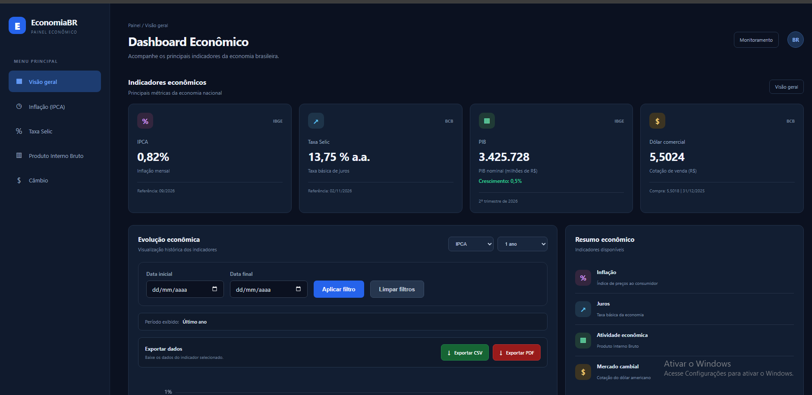
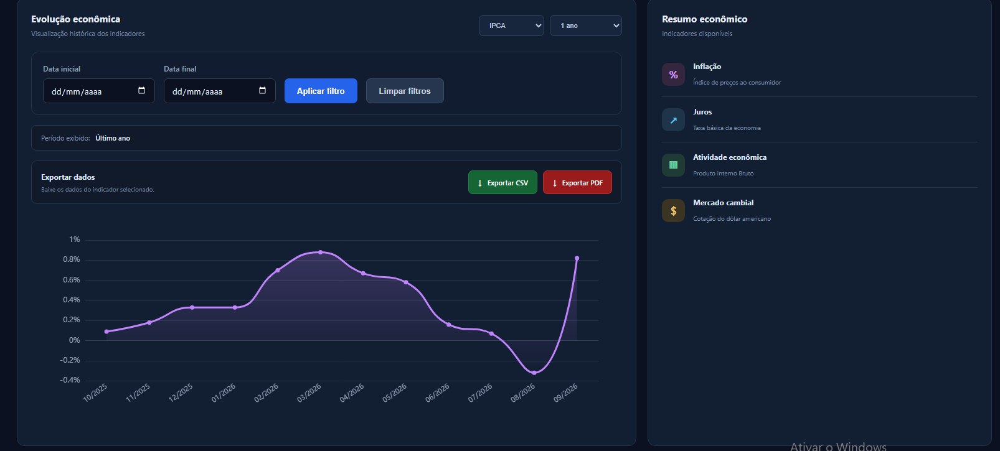
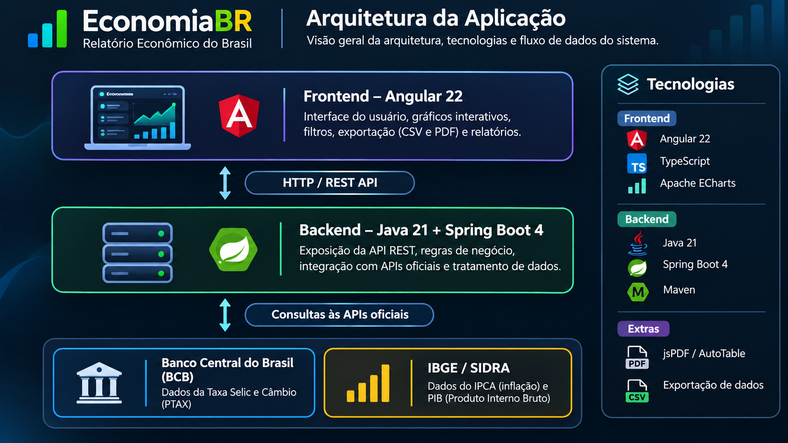
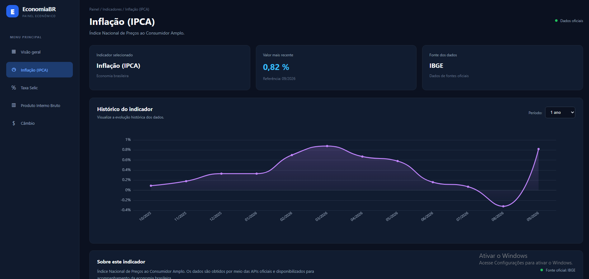
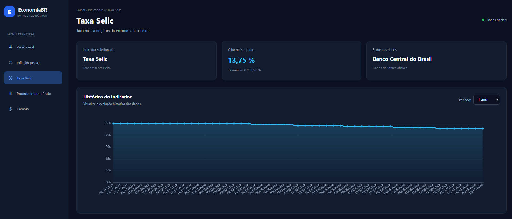
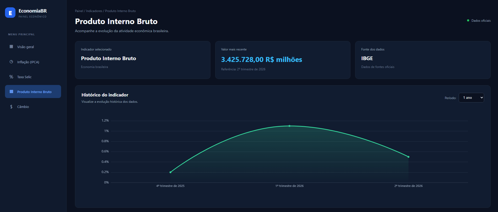
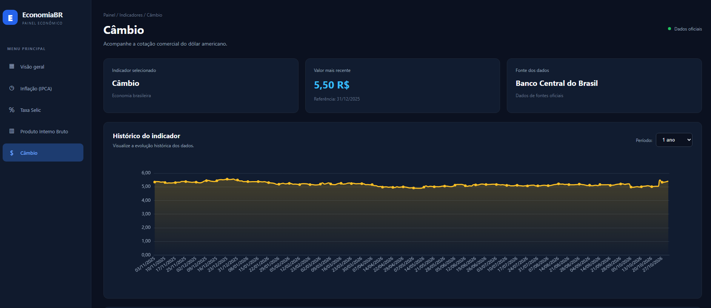
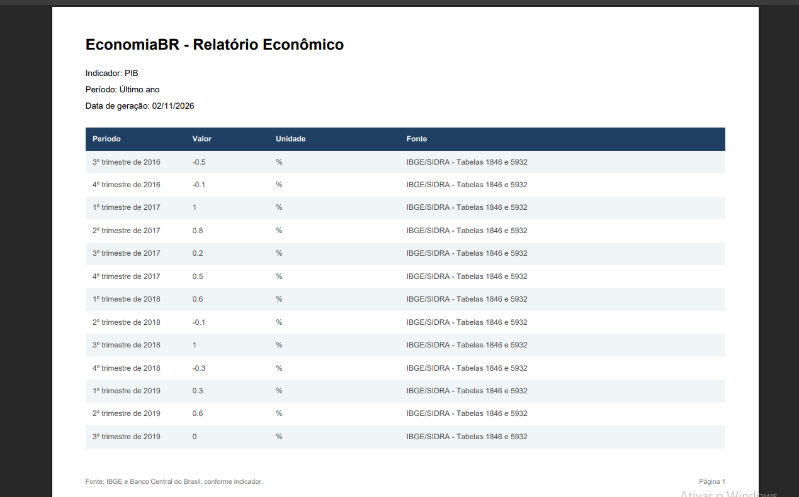

# 🇧🇷 EconomiaBR — Brazilian Economic Dashboard

A full-stack web application for monitoring and visualizing Brazil's main economic indicators through interactive charts, historical data, custom filters, and report exports.

EconomiaBR integrates official Brazilian economic data sources to provide an accessible and organized overview of the country's economic performance.

## 📊 Dashboard Preview



*Main dashboard featuring economic indicators, historical visualization, filters, and data export.*



## 🏛️ Application Architecture

EconomiaBR follows a full-stack architecture with a clear separation between the frontend, backend, and external data providers.



### Data Flow

1. **Frontend — Angular 22:** Handles the user interface, interactive charts, filters, and report exports.
2. **Backend — Java 21 and Spring Boot 4:** Provides REST endpoints, processes business logic, and integrates with external data providers.
3. **Official Data Sources:** Retrieves economic information from Banco Central do Brasil and IBGE/SIDRA.
4. **Visualization and Reports:** Presents the retrieved information through interactive charts and PDF/CSV exports.

### Main Components

| Layer | Technologies | Responsibility |
|---|---|---|
| Frontend | Angular, TypeScript, ECharts | User interface and data visualization |
| Backend | Java, Spring Boot, Maven | REST API and data processing |
| Data Providers | BCB, IBGE/SIDRA | Official economic information |
| Export | jsPDF, AutoTable, CSV | Report and data generation |


## 📈 Economic Indicators

EconomiaBR provides dedicated pages for four major Brazilian economic indicators.

### Inflation — IPCA



### SELIC Interest Rate



### Gross Domestic Product — GDP (PIB)



### Exchange Rate — USD/BRL



## 📄 Reports and Data Export

The application supports exporting economic indicator data in CSV and PDF formats.

The following screenshot demonstrates an example of a generated economic report:



## ✨ Features

- Interactive economic dashboard.
- Dedicated pages for each economic indicator.
- Historical data visualization.
- Interactive charts powered by Apache ECharts.
- Preset date filters and custom date ranges.
- Date interval validation.
- CSV data export.
- PDF report generation.
- Responsive interface for desktop and mobile devices.
- Integration with official Brazilian economic data sources.

## 🛠️ Technologies

### Backend
- Java 21
- Spring Boot 4
- Maven
- REST API
- JUnit 5
- Mockito

### Frontend
- Angular 22
- TypeScript
- Apache ECharts
- HTML5
- SCSS
- jsPDF
- jspdf-autotable

### Data Sources
- Banco Central do Brasil (BCB)
- Instituto Brasileiro de Geografia e Estatística (IBGE)

## 🏗️ Project Structure

```text
economia-brasil-dashboard/
│
├── backend/
│   ├── src/
│   │   ├── main/
│   │   └── test/
│   └── pom.xml
│
├── frontend/
│   └── dashboard-economia/
│       ├── public/
│       ├── src/
│       │   └── app/
│       │       ├── components/
│       │       ├── dashboard/
│       │       ├── models/
│       │       ├── pages/
│       │       └── services/
│       └── package.json
│
├── docs/
│   └── images/
│
└── README.md
```

## 🚀 Getting Started

### Prerequisites

- Java 21
- Node.js
- npm
- Git

### 1. Clone the repository

```bash
git clone https://github.com/diegosantos-io/economia-brasil-dashboard.git

cd economia-brasil-dashboard
```

### 2. Start the backend

Open a terminal:

```powershell
cd backend

.\mvnw.cmd spring-boot:run
```

### 3. Start the frontend

Open another terminal:

```powershell
cd frontend/dashboard-economia

npm install

ng serve -o
```

The application will be available locally through the Angular development server.

The backend must be running for the frontend to retrieve economic data.

## 🔌 API Endpoints

| Endpoint | Description |
|---|---|
| `/api/v1/indicadores` | Economic indicators overview |
| `/api/v1/indicadores/ipca?meses=24` | Historical IPCA data |
| `/api/v1/indicadores/selic?dias=30` | Historical SELIC data |
| `/api/v1/indicadores/pib` | GDP data |
| `/api/v1/indicadores/cambio?dias=30` | Exchange rate data |

## 🧪 Automated Tests

The project includes automated tests for the backend and frontend.

**Backend:**

```powershell
cd backend

.\mvnw.cmd test
```

**Frontend:**

```powershell
cd frontend/dashboard-economia

ng test --watch=false
```

### Latest validation

- Backend: 16 tests passed.
- Frontend: 2 tests passed.
- Angular production build: successful.

## 📚 Official Data Sources

- [Banco Central do Brasil](https://www.bcb.gov.br/)
- [IBGE](https://www.ibge.gov.br/)

## 🎯 Project Goals

EconomiaBR was developed as a portfolio project to demonstrate practical skills in:

- Full-stack application development.
- Java and Spring Boot.
- Angular and TypeScript.
- REST API integration.
- Data visualization.
- Automated testing.
- Responsive web development.
- Report generation and data export.

## 👨‍💻 Author

**Diego Santos**

Computer Science Student | Software Developer

- GitHub: [@diegosantos-io](https://github.com/diegosantos-io)
- LinkedIn: [Diego Santos](https://www.linkedin.com/in/diego-santos-3352a92a8/)

---

*Developed with a focus on technology, data visualization, and Brazilian economic indicators.*